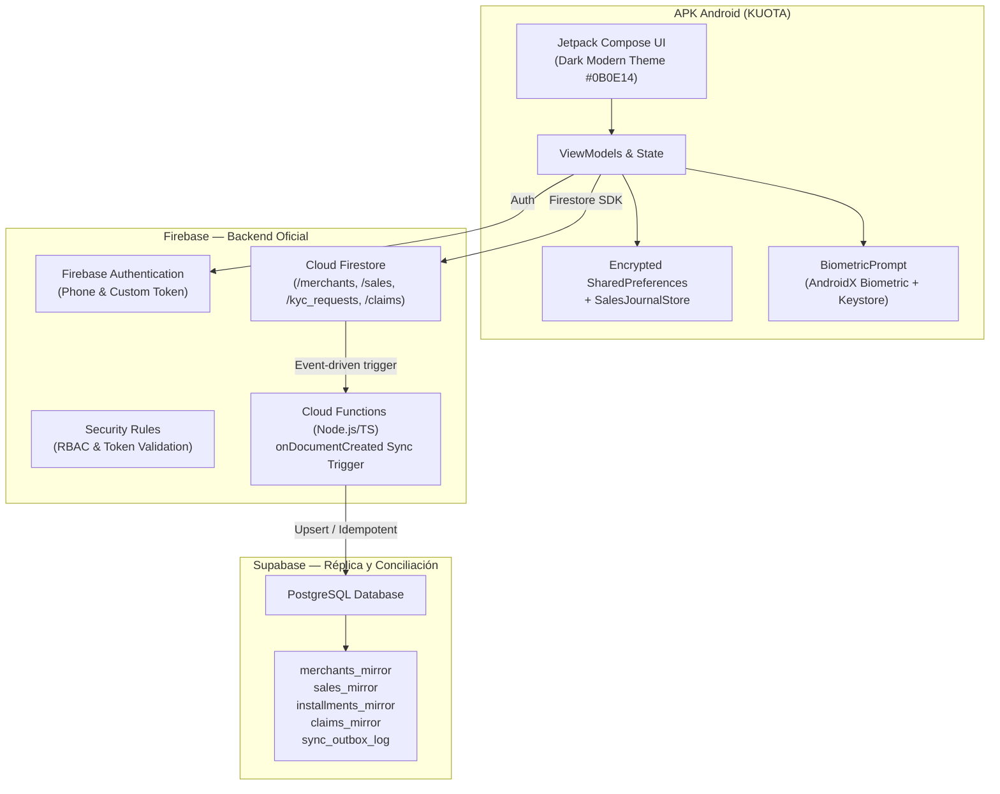

# KUOTA App — FinTech Android B2B Platform

> Aplicación móvil nativa en Kotlin & Jetpack Compose para financiamiento de compras B2B, adelanto de ventas con tarjeta y gestión de créditos a cuotas, integrada con arquitectura dual: **Firebase (backend principal)** y **Supabase PostgreSQL (réplica / mirror en tiempo real)**.

---

## 🏛️ Arquitectura del Sistema



---

## 🚀 Módulos y Funcionalidades Principales

### 1. Aplicación Android (`/app`)
- **UI / UX:** Jetpack Compose con paleta de diseño oscuro (`#0B0E14`), acentos en Azul y Cian (`#2563EB`, `#06B6D4`), tipografía adaptativa y soporte completo para pantallas compactas, densidades variadas y teclado abierto.
- **Verificación KYC DNI (Perú):**
  - Validación de 8 dígitos de DNI con dígito verificador.
  - Cámara integrada para captura frontal y posterior del documento.
  - Checkbox de consentimiento explícito bajo la **Ley N° 29733 (Protección de Datos Personales de Perú)**.
  - Registro directo en Cloud Firestore (`/kyc_requests/{requestId}`).
- **Límites de Tarjeta KUOTA:**
  - Manejo de importes exactos en centavos enteros (`Long`) para evitar errores de precisión de punto flotante en cálculos financieros.
  - Cálculo de disponible, consumido y asignado en tiempo real sincronizado con el historial de transacciones.
  - Catálogo de tarjetas: *Clásica*, *Gold*, *Platinum* y *Black Infinite*.
- **Selector de Medios de Pago Preferido:**
  - Selección entre Tarjeta KUOTA Clásica, Saldo a favor, Transferencia Bancaria Directa (BCP / Interbank / BBVA) y Billetera Digital (Yape / Plin).
  - Flujo de dos pasos con diálogo de confirmación antes de la persistencia.
- **Seguridad Biométrica y PIN:**
  - Integración nativa con `androidx.biometric:biometric-ktx`.
  - Fallback a PIN de 4 dígitos con cifrado SHA-256 y salt único en `EncryptedSharedPreferences`.
  - Mecanismo de bloqueo tras 3 intentos fallidos con temporizador de enfriamiento.

### 2. Backend Firebase (`/firebase`)
- **Cloud Firestore:**
  - Colecciones estructuradas con validación de esquemas: `merchants`, `sales`, `customers`, `kyc_requests`, `claims`.
  - Reglas de seguridad declaradas en `firestore.rules` con restricción de acceso por `request.auth.uid`.
- **Cloud Functions:**
  - Función `syncFirestoreToSupabase` para replicación asíncrona e idempotente hacia Supabase PostgreSQL.

### 3. Espejo Relacional Supabase (`/supabase`)
- Tablas PostgreSQL con soporte para conciliación bancaria, auditoría y trazabilidad:
  - `merchants_mirror`
  - `sales_mirror`
  - `installments_mirror`
  - `claims_mirror`
  - `sync_outbox_log` (para trazabilidad de reintentos e idempotencia)

### 4. Servicio Backend Ktor (`/backend`)
- Servicio de soporte en Kotlin / Ktor para emisión y firma de códigos QR dinámicos, webhooks de proveedores de pago y libro contable *append-only*.

---

## 🛠️ Requisitos Previos

- **Android Studio** Ladybug o superior (Gradle JDK 17 o 21).
- **Android SDK:** `compileSdk = 35`, `minSdk = 26`, `targetSdk = 35`.
- **Node.js** v20+ (para Firebase Functions).
- **Firebase CLI** (`npm install -g firebase-tools`).

---

## 💻 Compilación y Ejecución

### Compilar APK Android
```bash
# Compilar variante Debug
./gradlew assembleDebug

# Ejecutar pruebas unitarias
./gradlew testDebugUnitTest
```
El APK resultante se genera en:
`app/build/outputs/apk/debug/app-debug.apk`

### Desplegar Reglas de Firebase
```bash
cd firebase
firebase deploy --only firestore:rules
```

---

## 🔐 Variables de Entorno y Secretos

Por motivos de seguridad, los archivos de credenciales confidenciales están excluidos mediante `.gitignore`:
- `local.properties` (Android SDK y firma privada)
- `firebase/functions/.env` (Contiene `SUPABASE_SERVICE_ROLE_KEY`)

Para configurar un nuevo entorno de servidor, duplica `firebase/functions/.env.example` como `.env` y asigna tus claves de Supabase correspondientes.

---

## 📄 Licencia

Propiedad exclusiva de **KUOTA S.A.C.** — Todos los derechos reservados.
